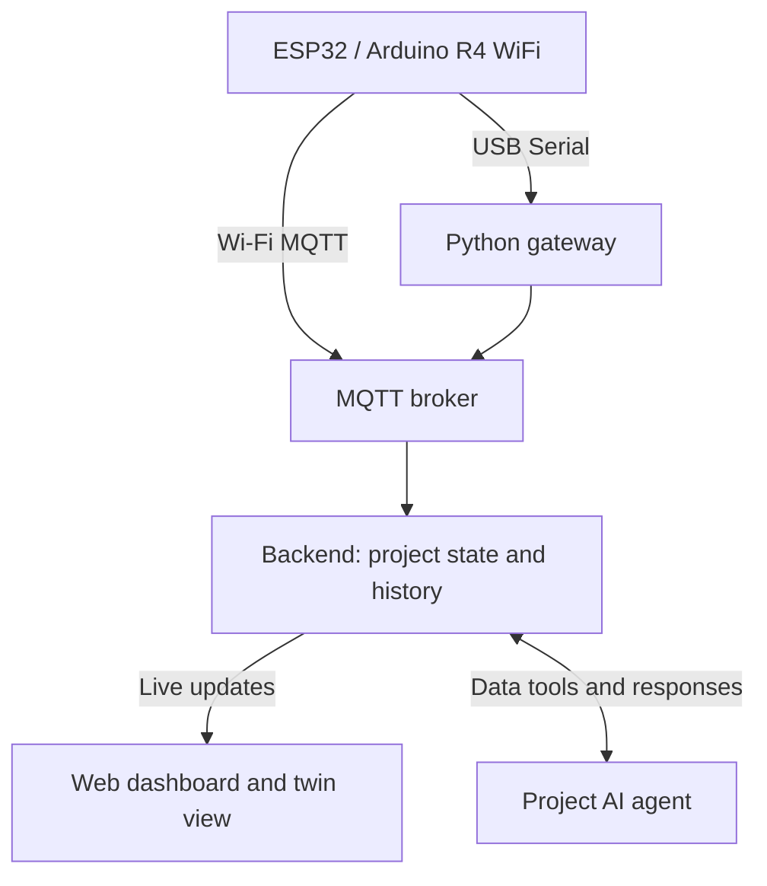

# إدراك | IDRAK

**A shared intelligence platform for IoT systems**

Team overview · Hackathon track: **AI and Data** · Proposed MVP

## 1. The idea

IDRAK brings different IoT projects into one platform. Each project gets:

- A **live digital view** of its devices, readings, connections, and status.
- A **dedicated AI agent** that uses the project's data to answer questions, explain changes, and recommend actions.
- A shared dashboard for monitoring, alerts, history, and approved control.

The goal is to make intelligent operation reusable across projects. A temperature sensor, a water monitor, and a connectivity monitor are examples we can connect to the platform.

“Supports different IoT systems” means using supported connectors and describing each system's sensors, units, relationships, and available commands. Adding a new type of equipment may require a new connector or template.

## 2. Problem and solution

**Problem:** Teams managing several IoT projects often repeat the same work: connecting devices, building dashboards, setting alerts, and investigating unexpected readings. The data exists, but someone still has to gather the context and decide what to do.

**Solution:** IDRAK provides one reusable platform that connects devices, maintains their current state, and gives each project an agent with access to its readings, history, and permitted tools.

**The value to demonstrate:** Add a second project without rebuilding the application, then show an explanation or action supported by actual device data.

## 3. The pitch

> Smart devices generate data, but teams still build separate monitoring and decision logic for every project. IDRAK gives each connected system a live digital representation and a dedicated AI agent in one platform. The agent checks readings and history, explains unusual changes, and recommends or performs approved actions. Our hackathon prototype connects ESP and Arduino systems to demonstrate temperature and connection monitoring. Our goal is simple: connect a system, describe its components, and give it an agent that works with its data and available actions.

## 4. What we need to build

The hackathon MVP should include:

1. **Project setup:** Choose a template, register a device, and define its fields and units.
2. **Data connection:** Receive real readings from ESP and Arduino UNO R4 WiFi.
3. **Live state:** Store current readings, timestamps, device status, and history.
4. **Digital twin view:** Show components and relationships, with values that update as data arrives.
5. **Project agent:** Answer questions using tools that retrieve real project data.
6. **Events:** Detect one useful condition, such as a temperature threshold or missing heartbeat.
7. **Action and verification:** If an actuator is available, send an approved command and check the result.
8. **Two projects:** Demonstrate reuse through the same interface and backend.

**Stretch goals:** One anomaly model, one calibrated simulation, or a third demo project. Complete the working data-to-agent flow first.

## 5. Hardware and demo projects

**Yes: ESP and Arduino UNO R4 WiFi can send readings to IDRAK.** We will assume an ESP32 development board and confirm the exact variant before selecting libraries. The [UNO R4 WiFi includes Wi-Fi connectivity](https://docs.arduino.cc/hardware/uno-r4-wifi/). Both boards can also connect to the laptop through USB Serial.

Each board connects independently to the platform; they do not need to connect to each other.

| Demo | Hardware | What judges see |
| --- | --- | --- |
| Temperature | ESP32 or R4 WiFi + compatible temperature sensor | A real reading updates the digital view; the agent explains a change using recent readings. |
| Connection health | The other board; no extra sensor required | Heartbeats update “last seen.” Pausing messages produces a missing-data event; resuming them shows recovery. |
| Water, optional | Either board + compatible level or leak sensor | Changing the water level or wet/dry state updates a separate project and its agent. |

**Recommended scope:** Temperature plus connection health. Add water only if the first two work reliably. Connection monitoring measures device reachability; missing messages alone do not establish the cause. RF equipment is not needed for this demo.

**Equipment:** Boards, USB data cables, laptop, breadboard, jumper wires, and a compatible temperature sensor. Optional: water sensor, private Wi-Fi router, or a small low-voltage fan with a suitable driver and power supply. Match sensor voltages to the selected board; do not power a fan directly from a GPIO pin.

## 6. How data reaches the platform

We can support two routes using the same backend:

| Route | How it works | When to use it |
| --- | --- | --- |
| Wi-Fi + MQTT | The board publishes messages to a Mosquitto broker running on the laptop. The backend subscribes to them. | Wireless demo on a tested private network. |
| USB Serial gateway | The board sends JSON over USB. A small Python gateway reads it and publishes it to the same broker. | Reliable starting point and fallback in a crowded venue. |

MQTT is the messaging protocol; the broker routes messages between devices and software. Use [Mosquitto](https://mosquitto.org/documentation/) for the broker and [pySerial](https://pyserial.readthedocs.io/en/latest/shortintro.html) for the USB gateway. HTTP is another possible connector, but one working route is enough to start.



Example device message, with illustrative values:

```json
{
  "project_id": "temperature-demo",
  "device_id": "esp32-01",
  "sequence": 42,
  "uptime_ms": 84000,
  "readings": {
    "temperature_c": 28.4
  }
}
```

The backend validates the message, adds a receipt timestamp, maps the reading to the registered component, stores it, and updates the browser. Missing or old data must appear as stale, rather than as a fresh reading. The gateway's own status helps distinguish gateway failure from a device going silent.

Commands travel back through the selected route. A device acknowledgement confirms receipt; a follow-up measurement or state report is needed to verify the intended result.

Run the dashboard, backend, database, and broker on the laptop for the demo. A cloud LLM still needs internet even when sensor data arrives over USB.

## 7. What the digital twin means here

The digital representation combines **system structure + current state + history**. For a temperature project, it might contain a room, a sensor, and an optional fan, with their relationships and latest states.

We create it by:

1. Defining a template: components, fields, units, and permitted actions.
2. Mapping incoming device readings to those components.
3. Updating values and status as new readings arrive.
4. Adding a behavior model only when we want simulation or prediction.

For a sensor-only project, this is a live digital representation, often called a **digital shadow**. A predictive twin needs an additional model that has been checked against the real system. Receiving data does not automatically create an accurate physics simulation.

**Recommended visual tool:** [React Flow](https://reactflow.dev/) for a simple interactive component diagram. A 3D model is optional.

**MATLAB/Simulink:** Useful if the team wants to model physical behavior, such as temperature response to a fan. [Simulink](https://www.mathworks.com/products/simulink.html) supports model-based simulation. It can be an optional simulation engine; React Flow handles the web view. For this MVP, start with the live view and add simulation only if the team has the time, licenses, and experience.

## 8. AI agents, LLMs, and ML models

Each project gets its own agent configuration: system description, recent state, history access, and allowed actions. All agents can share one LLM; we do not train a separate model for each device.

Example tools: `get_current_state`, `get_recent_readings`, `get_events`, and, where supported, `request_action`.

| Component | Job in IDRAK |
| --- | --- |
| Rules and basic statistics | Detect missing heartbeats, thresholds, and unusual rates of change. This is the starting baseline. |
| LLM agent | Retrieve evidence, explain events, answer questions, and select permitted tools. |
| Isolation Forest, optional | Flag unusual patterns after collecting representative normal data. An anomaly score does not identify the fault's cause. |
| Linear regression, optional | Estimate a short trend from recent readings; show uncertainty and validate it before using it for decisions. |
| Simulation model, optional | Estimate a specific system's behavior for “what if?” questions. |

For ML, collect our own hardware readings across several normal and changed conditions. Evaluate on separate runs and compare against the simple rules. [Scikit-learn's anomaly detection documentation](https://scikit-learn.org/stable/modules/outlier_detection.html) is a useful starting point.

### LLM recommendation

| Choice | Recommendation |
| --- | --- |
| Start with one hosted model | [GPT-5.6 Luna](https://developers.openai.com/api/docs/models/gpt-5.6-luna) supports function calling and structured outputs. Test it on our project questions and tool calls before committing. |
| Local option | [Qwen3-8B](https://huggingface.co/Qwen/Qwen3-8B), only if it runs reliably on the available laptop. Local performance depends on hardware and configuration. |

The LLM runs through an API or on a capable computer, not on the ESP or R4. Call it when a user asks a question or an event needs analysis, rather than for every sensor sample.

Keep API keys in the backend. The backend checks action permissions and data freshness before sending a command; firmware enforces local limits. Start with read-only analysis, then enable one bounded action if ready.

## 9. Website and tech stack

The website is the IDRAK application. It needs three main screens:

- **Overview:** All projects, current status, last update, and active events.
- **Project page:** Digital view, charts, agent chat, and action history.
- **Add project:** Template, device identity, field mapping, and allowed actions.

| Layer | Proposed tool |
| --- | --- |
| Board firmware | Arduino IDE, C++, board-compatible Wi-Fi/MQTT libraries |
| Frontend | React + TypeScript + Vite; CSS or Tailwind for styling |
| Digital view and charts | React Flow + Recharts |
| Backend | Python + FastAPI; WebSockets for browser updates |
| Device messaging | Mosquitto + Python Paho MQTT client |
| USB connector | Python + pySerial |
| Storage | SQLite for project definitions, readings, events, and actions |
| Agent integration | Chosen LLM provider's SDK with a small tool-calling loop |
| Optional ML | scikit-learn |
| Optional simulation | MATLAB/Simulink or a small validated Python model |

The first working version can run entirely on the presentation laptop, apart from the hosted LLM. A public website deployment can follow after the device connection and demo are stable.

## 10. Build order and judging demo

**Build order:** Connect one sensor → receive and store readings → show live state → add the agent → add events and an optional action → register the second project → rehearse.

Suggested ownership: hardware/firmware, backend/data, frontend/twin view, and agent/demo. Combine roles according to team size.

**A three-minute demo:**

1. Show two projects on the same dashboard.
2. Change the temperature reading physically and show the live update.
3. Ask the agent what changed; show the readings and timestamps behind its answer.
4. Pause and resume the second board's messages; show detection and recovery.
5. If ready, run one approved actuator command and show the observed result.

Success means both real devices feed the platform, stale data is visible, agent answers use the correct project's evidence, and the second project reuses the same software. Record update delay and event-detection delay during rehearsal. Label any replay or simulated data clearly.

**Main reference:** `IDRAK_Project_Brief.md` contains the detailed architecture, alternatives, and longer implementation plan. This file is the team's simpler starting brief.
