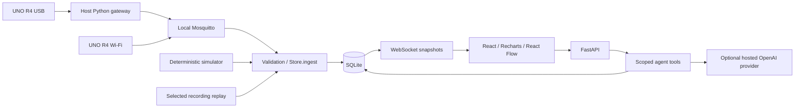

# Agentwin

**Every system. Its own agent.** A local IoT monitoring MVP with an Obsidian Plum React interface, persistent FastAPI backend, project-scoped agent tools, simulation, replay, MQTT ingestion, and a USB gateway.

> For the current multi-project workflow, use the [operator guide](docs/operator-guide.md). It supersedes older single-LED UI descriptions in this README.

The first physical acceptance path controls an external LED on UNO R4 pin D7 through the live USB gateway and confirms the result through device telemetry. Simulation remains available as an explicitly selected test source. No physical test is claimed until the wiring procedure is performed.

## Run locally (Windows primary path)

Prerequisites: Python 3.14 and Node 24 were used for verification. Install dependencies from the repository root:

```powershell
python -m venv .venv
.\.venv\Scripts\python.exe -m pip install -r requirements.lock
npm.cmd --prefix frontend ci
npm.cmd --prefix frontend run build
Copy-Item .env.example .env
.\.venv\Scripts\python.exe -m uvicorn backend.main:app --host 127.0.0.1 --port 8000
```

Open **http://127.0.0.1:8000**. Select Smart Systems Connectivity → **Start normal**. Neither Docker, connected hardware, nor an LLM key is needed for simulation. Alternatively `powershell -File scripts/start.ps1` starts an already built app. Avoid overwriting an existing `.env` when repeating setup.

On Linux/macOS use `.venv/bin/python` and `npm` instead of the Windows executable paths. That OS path has not been executed in this Windows environment.

For frontend development, keep the backend running and use `npm.cmd --prefix frontend run dev`, then http://127.0.0.1:5173. Vite proxies API/WebSocket traffic; the production build is served by FastAPI. Restart FastAPI after the first frontend build so static routes are registered.

Optional real-device broker:

```powershell
docker compose up -d broker
```

Compose binds Mosquitto only to `127.0.0.1:1883`. The backend retries broker connection independently. Docker's engine was unavailable during this build; see the verification record for the exact integration tests performed. A native Mosquitto process is also supported. See [hardware integration](docs/hardware.md) for USB and private-network setup.

## What works

- Overview, project workspace, add-project flow, events and useful setup settings.
- Editable starting templates with multiple devices, supported components, typed fields, scoped capabilities, and project-scoped agent configuration.
- Deterministic normal/level-change/pause/recovery simulations through the **same Store.ingest validation and storage boundary** as MQTT. UI components never generate readings. The simulator calls ingestion directly so a broker is not required for a laptop demo.
- SQLite project definitions, source sessions, readings, events, actions, and successful agent conversations survive restart. A fresh database contains no hardcoded projects. Simulation producers are intentionally not resumed automatically after restart.
- Live, simulated and replay histories and latest-state calculations are session-isolated. Replay explicitly selects the currently viewed original recording, keeps original provenance/timestamps and replays at most its latest 180 samples. Replay does not trigger fresh operational events.
- WebSocket snapshots update the overview and project workspace every second. Reconnect loads the current state via HTTP and resumes snapshots; charts/browser readings are bounded to 180 samples. Missing samples produce chart gaps.
- Device/project/topic validation, strict versioned schema, finite/range/type checks, deduplication, retired-boot rejection, retained-message rejection, server receipt timestamps and connector-derived source metadata.
- Deterministic missing-telemetry and high-limit rules with three-sample level debounce, a ten-second recurrence cooldown and explicit recovery. Acknowledgement is a separate operator action.
- Server-side OpenAI Responses integration with six structured tools, project/session binding, bounded calls/timeout, structured findings and stored evidence references. Offline/missing-key failures explicitly display **AI agent unavailable**.
- Arduino USB telemetry plus a reconnecting pySerial/Paho gateway with availability reporting and live-only LED command forwarding. Requested actions remain separate from telemetry-confirmed completion.

## Architecture and contracts



`backend/models.py` owns request/message validation; generated telemetry schema is in `schemas/telemetry-v1.json`. `backend/templates.py` owns reusable fields/components/relationships. `backend/store.py` owns persistence and deterministic event rules. `backend/runtime.py` handles MQTT, simulation and replay. `backend/agent.py` owns tools and provider integration. `gateway/`, `firmware/`, `simulator/`, `frontend/`, `tests/`, and `docs/` contain their corresponding layers.

API explorer: http://127.0.0.1:8000/docs. Project/session IDs in routes select the local operator's context; agent tool arguments cannot change it. This is a **single local operator MVP, not a multi-tenant authorization system**. The LED action API accepts only the declared `set_led` capability in a live session with an online gateway and broker. Agent proposals never execute physical actions.

### AI security and evidence

Device labels, descriptions and stored conversation content are data, not trusted instructions. Tool arguments use strict schemas with no arbitrary URLs, code, SQL, or project override. Event references are checked within project/session before proposing actions. Credentials stay in server environment variables. Calls have a 45-second overall timeout, 15-second request timeout, four turns and eight tool calls maximum. No calls occur per sensor sample; user questions invoke the provider.

Set `OPENAI_API_KEY`, `LLM_PROVIDER=openai` and `LLM_MODEL` in `.env`, then restart. The starting model `gpt-5.6-luna` is documented in the [official model page](https://developers.openai.com/api/docs/models/gpt-5.6-luna); [Responses function calling](https://developers.openai.com/api/docs/guides/function-calling) is implemented using the installed SDK. Account access, credentials and live response quality have not been verified. Tests use a fake provider to verify the real tool loop without fabricating a live conversation in the product.

Only server-generated references to stored readings/events render as evidence. They do not guarantee that every model statement is correct; unsupported/invalid references are removed. Missing evidence is disclosed. Monitoring/rules work without any API key or internet. Provider-configured status means configuration exists, not that a request succeeded.

## Configuration and assumptions

The attached build prompt overrides the original IDRAK briefs: public name **Agentwin**, track **AI and Data**, first showcase **Smart Systems Connectivity / اتصال الأنظمة الذكية**, UNO R4 WiFi + AD8313 and passive RF inventory. The original three reference Markdown documents remain intact.

- Default freshness 8 seconds, sampling 1 second, high detector limit 1.6 V; these are demo defaults, not measured operating limits. Generic seed uses °C and limit 30, explicitly synthetic. A new project defines its own unit/field/limit.
- Overview and project routes use **live** sessions by default. Simulation remains available from the source selector and never replaces a disconnected live source.
- Each telemetry packet explicitly registers its boot session. A newly observed boot can arrive late, retires the prior boot for that device, and old-session or out-of-order packets are rejected. MQTT telemetry is non-retained and browser/API histories are bounded.
- ADC defaults: 12 bits, nominal 5 V, A0. RF dBm is always unavailable in this version because no valid setup calibration exists. Module supply/pinout remains unresolved pending hardware identification.
- One SQLite writer process; run **one Uvicorn worker**. No cloud deployment, application authentication, OTA changes, calibration editor, trained anomaly detection, or behavioral prediction is included. Physical control is limited to declared LED capabilities.
- Each project has configurable reading retention; cleanup deletes at most 200 expired readings per evaluation. Events and actions are preserved. Back up `data/agentwin.db` while stopped or use SQLite backup tooling.
- English-first interface with Arabic-capable fallback and direction-aware project titles. Core labels are centralized; complete localization extraction remains future work.

## Verify and rehearse

```powershell
.\.venv\Scripts\python.exe -m pytest -q
npm.cmd --prefix frontend run lint
npm.cmd --prefix frontend run typecheck
npm.cmd --prefix frontend run build
# With backend running on 8000 and Microsoft Edge installed:
npm.cmd --prefix frontend run smoke
# CLI simulation controls:
.\.venv\Scripts\python.exe -m simulator.run --scenario normal
.\.venv\Scripts\python.exe -m simulator.run --scenario pause
.\.venv\Scripts\python.exe -m simulator.run --scenario recovery
```

Browser tests create a verification project and simulated/replay histories in the running database. Use a separate `DATABASE_PATH` for test runs. See [verification](docs/verification.md), [three-minute demo](docs/demo.md), [hardware guide](docs/hardware.md), and [CI/CD backlog](docs/backlog.md).

The optional serial/MQTT protocol test uses a local Aedes test fixture because Mosquitto/Docker was unavailable. Run it with `$env:RUN_MQTT_TESTS='1'` before pytest. Deployment remains configured for Mosquitto; passing this fixture does not certify broker ACLs or physical serial hardware.
