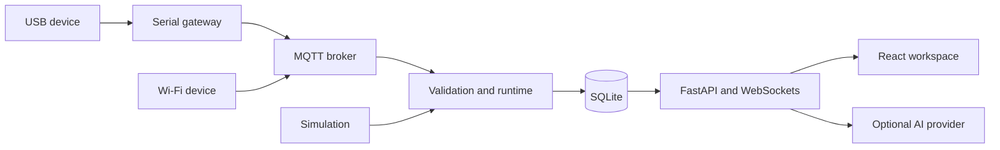

# Agentwin

**Every system. Its own agent.**

Agentwin is a local-first IoT monitoring application built with FastAPI, SQLite,
React, and TypeScript. Register devices, inspect telemetry and digital twins,
track alerts, and use a project-scoped assistant to explain stored evidence.

Start with simulated data on your laptop. Hardware, an MQTT broker, an AI service,
and email delivery are optional.

## Features

- Persistent project definitions, readings, events, actions, and conversations.
- Separate Live and simulated histories with explicit source labels.
- Validated MQTT telemetry and a USB serial gateway for physical devices.
- Charts, event history, and 2D physical, data-flow, and topology views.
- Silence alerts, configurable numeric thresholds, and scheduled summaries.
- Hardware Templates and per-device firmware packages for the classic Arduino UNO
  D13 LED and UNO R4 WiFi RF detector.
- Optional LM Studio or OpenAI integration. Device telemetry must confirm a
  physical command before it is marked complete.

**Status:** a single-operator MVP for local development and private-network
experiments. The application has no user authentication or tenant isolation.
Keep the web app on loopback; it is not ready for direct public hosting.

## Quick start

### 1. Install prerequisites and clone

You need Git, **Python 3.12 or 3.13**, and **Node.js 24 LTS** with npm. Python 3.12
and Node.js 24 are validated by the development checks. Docker is optional.

```bash
git clone https://github.com/SalehBaderah/Agentwin.git
cd Agentwin
```

Run all following commands from this repository root unless stated otherwise.

### 2. Install dependencies and build the frontend

**macOS / Linux:**

```bash
python3 -m venv .venv
.venv/bin/python -m pip install -r requirements.lock
npm --prefix frontend ci
npm --prefix frontend run build
```

**Windows PowerShell:**

```powershell
py -3.12 -m venv .venv
.\.venv\Scripts\python.exe -m pip install -r requirements.lock
npm.cmd --prefix frontend ci
npm.cmd --prefix frontend run build
```

Use `py -3.13` if you installed Python 3.13. These commands use the checked-in
lockfiles; you do not need to activate the virtual environment.

### 3. Create local configuration

Copy `.env.example` to `.env` **only if `.env` does not already exist**:

```bash
# macOS / Linux
cp -n .env.example .env
```

```powershell
# Windows PowerShell
if (-not (Test-Path .env)) { Copy-Item .env.example .env }
```

The defaults use `data/agentwin.db`, listen for MQTT on `127.0.0.1:1883`, and
set `LLM_PROVIDER=none`. Leave credentials empty for the hardware-free workflow.
The backend loads `.env` automatically. Restart it after changing configuration.
See the [configuration reference](docs/configuration.md) for optional integrations.

### 4. Start the application

**macOS / Linux:**

```bash
.venv/bin/python -m uvicorn backend.main:app --host 127.0.0.1 --port 8000 --workers 1
```

**Windows PowerShell:**

```powershell
.\.venv\Scripts\python.exe -m uvicorn backend.main:app --host 127.0.0.1 --port 8000 --workers 1
```

Open **http://127.0.0.1:8000**. API documentation is at
**http://127.0.0.1:8000/docs**, and readiness is at `/api/health`.
A fresh database has no projects. `status: "ready"` with `mqtt: false` and
`agent_available: false` is expected when those optional services are absent.

Use **one worker** because SQLite has a single writer. Stop the server with Ctrl+C.

### 5. Try simulated telemetry

1. Select **Add project** → **Custom configuration**.
2. Name the project, keep the default device and field, and continue through the
   configuration steps. Create the project.
3. Copy the project ID from the address bar (`/projects/<project-id>`). In a second
   terminal at the repository root, replace `PROJECT_ID` and run:

   ```bash
   # macOS / Linux
   .venv/bin/python -m simulator.run --project PROJECT_ID --scenario normal
   ```

   ```powershell
   # Windows PowerShell
   .\.venv\Scripts\python.exe -m simulator.run --project PROJECT_ID --scenario normal
   ```

4. In the workspace's **Session** selector, choose the entry beginning `simulated`.
   Inspect **Live readings**, **Digital twin**, and **Events & history**.
   Use the CLI with `--scenario pause`, `recovery`, or `stop` to control the stream.
   These commands do not verify physical devices or send hardware commands.

Projects and readings persist across restarts. Simulation producers must be
started again after restarting the backend. See [local development](docs/local-development.md)
for CLI simulation and an isolated browser test database.

## Development and tests

For frontend hot reload, keep the backend running and start a second terminal:

```bash
npm --prefix frontend run dev
```

Open **http://127.0.0.1:5173**. Vite proxies `/api` and WebSockets to the backend
on port 8000. Rebuild the frontend to update the version served directly by FastAPI.

Run the core checks from the root:

```bash
# macOS / Linux; on Windows use .\.venv\Scripts\python.exe instead.
.venv/bin/python -m pytest -q
npm --prefix frontend run lint
npm --prefix frontend test
npm --prefix frontend run build
```

The build includes TypeScript checking. MQTT integration and real-model tests
are opt-in; see [test instructions](docs/local-development.md#tests).
For browser smoke tests, install Playwright Chromium and use a disposable database
as described in [browser checks](docs/local-development.md#browser-checks).

## How it fits together



| Directory | Responsibility |
| --- | --- |
| `backend/` | API, telemetry validation, persistence, monitoring, and agent tools |
| `frontend/` | React UI, digital twins, and browser checks |
| `gateway/` | USB serial-to-MQTT bridge |
| `simulator/` | Synthetic-session controls and optional virtual MQTT devices |
| `firmware/` | Hardware Templates, sketches, and shared Arduino libraries |
| `broker/` | Local Mosquitto configuration examples |
| `schemas/` | Versioned telemetry contract |
| `tests/`, `evals/` | Backend tests and operational-agent evaluation |
| `docs/` | Setup, architecture, hardware, and contributor references |

## Documentation

- [Local development and troubleshooting](docs/local-development.md)
- [Environment variables, AI, MQTT, and email](docs/configuration.md)
- [Connect and flash supported hardware](docs/hardware-setup.md)
- [Develop a Hardware Template](docs/hardware-templates.md)
- [Platform architecture and contracts](docs/platform-overview.md)
- [Operational-agent evaluation](evals/granite/README.md)
- [Contributing](CONTRIBUTING.md) · [Security policy](SECURITY.md)
- [Public-release review and simplification roadmap](docs/open-source-readiness.md)

## Limitations

Physical-device workflows require compatible firmware, a reachable broker, and
local USB or network access. RF detector voltages and the included classifier do
not establish calibrated RF power, a frequency spectrum, or proof of jamming.
AI output is explanatory and can be wrong; stored evidence and deterministic
validation remain the source of operational state. See [security boundaries](SECURITY.md).

## License

Created by [SalehBaderah](https://github.com/SalehBaderah).

Agentwin's original code is available under the [MIT License](LICENSE).
Dependencies and third-party materials retain their own licenses.
