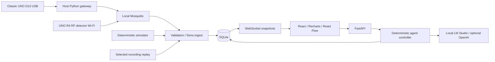

# Agentwin

**Every system. Its own agent.** A local IoT monitoring MVP with an Obsidian Plum React interface, persistent FastAPI backend, project-scoped agent tools, simulation, replay, MQTT ingestion, and a USB gateway.

Two physical projects share one backend and MQTT broker:

| Project | Board | Connection | Local project ID |
| --- | --- | --- | --- |
| `arduino_uno_d13_led` | Classic UNO, built-in D13 LED | USB on `COM4` -> Python gateway -> MQTT | `project-1b000f5096` |
| `R4_jamming_detector` | UNO R4 WiFi, AD8313 on A5 | Wi-Fi -> MQTT; USB-C is for flashing/power | `project-6309ff857a` |

COM ports, project IDs, and LAN IPs can change. Confirm them on your machine. Use each project's **Live** session for physical readings; simulation is separate.

## Run both projects (Windows PowerShell)

Run commands from the repository root. On a fresh checkout, install and build once:

```powershell
python -m venv .venv
.\.venv\Scripts\python.exe -m pip install -r requirements.lock
npm.cmd --prefix frontend ci
npm.cmd --prefix frontend run build
```

Create `.env` from `.env.example` only if it does not exist. Also create `broker/private-network.conf` from its `.example`, `broker/acl`, `broker/passwords`, and R4 `secrets.h` from `secrets.example.h`. These files are ignored by Git. Do not overwrite working credentials or copy password **hashes** from `broker/passwords` into `.env` or firmware.

For daily use, open separate PowerShell windows for the broker, backend, and classic UNO gateway:

```powershell
docker compose up -d broker
```

```powershell
.\.venv\Scripts\python.exe -m uvicorn backend.main:app --host 127.0.0.1 --port 8000
```

```powershell
.\.venv\Scripts\python.exe -m gateway.serial_gateway --port COM4 --baud 38400 --project project-1b000f5096 --device uno-d13-01
```

Open **http://127.0.0.1:8000**. Keep the classic UNO on USB and run **one** gateway for it. The R4 publishes directly over Wi-Fi, including on battery; **do not run a serial gateway for the R4**. Close Arduino Serial Monitor while the gateway owns the UNO port.

### MQTT setup (once)

Use `ipconfig` to find the computer's LAN IPv4 address. In `.env`, set `MQTT_HOST` and `MQTT_BIND_IP` to that address, `MQTT_PORT=1883`, `MQTT_USERNAME=agentwin-backend`, and its **plain** `MQTT_PASSWORD`. The backend and USB gateway share this account. In R4 `secrets.h`, set your Wi-Fi credentials and the same MQTT host/port; use `#define MQTT_USER "r4-rf-01"` and `#define MQTT_PASSWORD "plain-r4-password"` with C++ quotes. The R4 must be on a network that can reach the computer; allow inbound TCP 1883 on the Windows **Private** network only.

Create the broker accounts. Both commands prompt for passwords. The first command's `-c` **replaces** an existing password file, so use it only on first setup; omit `-c` when resetting or adding accounts:

```powershell
docker run --rm -it -v "${PWD}\broker:/mosquitto/config" --entrypoint mosquitto_passwd eclipse-mosquitto:2.0.22 -c /mosquitto/config/passwords agentwin-backend
docker run --rm -it -v "${PWD}\broker:/mosquitto/config" --entrypoint mosquitto_passwd eclipse-mosquitto:2.0.22 /mosquitto/config/passwords r4-rf-01
```

Put these permissions in ignored `broker/acl` (replace project IDs if yours differ). The classic UNO gateway shares the backend account, so it needs **write** permission for the UNO topics:

```text
user agentwin-backend
topic read agentwin/+/+/telemetry
topic read agentwin/+/+/status
topic write agentwin/+/+/command
topic read agentwin/project-1b000f5096/uno-d13-01/command
topic write agentwin/project-1b000f5096/uno-d13-01/telemetry
topic write agentwin/project-1b000f5096/uno-d13-01/status

user r4-rf-01
topic write agentwin/project-6309ff857a/r4-rf-01/telemetry
topic write agentwin/project-6309ff857a/r4-rf-01/status
topic read agentwin/project-6309ff857a/r4-rf-01/command
```

Restart the broker after editing `broker/acl` or `broker/passwords`.

### Flash a board when its firmware changes

Connect the board by USB, close Serial Monitor, and stop the classic UNO gateway if it owns that board's COM port. The Arduino IDE includes `arduino-cli` at this path; use `board list` to confirm which COM port belongs to which board. Compile and upload only the board you changed:

```powershell
$cli = "$env:LOCALAPPDATA\Programs\Arduino IDE\resources\app\lib\backend\resources\arduino-cli.exe"
& $cli board list
& $cli compile --fqbn arduino:avr:uno --libraries firmware/libraries firmware/projects/arduino_uno_d13_led
& $cli upload --port COM4 --fqbn arduino:avr:uno firmware/projects/arduino_uno_d13_led
& $cli compile --fqbn arduino:renesas_uno:unor4wifi --libraries firmware/libraries firmware/projects/R4_jamming_detector
& $cli upload --port COM3 --fqbn arduino:renesas_uno:unor4wifi firmware/projects/R4_jamming_detector
```

The classic UNO firmware and gateway must both use **38400 baud**. After uploading it, restart the gateway. The R4 needs no gateway; reflash it after changing `secrets.h` or firmware. Its built-in D13 LED is a connection indicator: **fast blink** = no Wi-Fi, **slow blink** = Wi-Fi but no MQTT, **solid** = MQTT connected. If it never lights on battery, check power first. The AD8313 provides a detector voltage and MLP output, not a calibrated frequency spectrum. See the [R4 hardware notes](firmware/projects/R4_jamming_detector/README.md).

### Quick checks

- `http://127.0.0.1:8000/api/health` should show `"mqtt": true`; both projects should show fresh **Live** readings.
- Broker `not authorised`: check the account's **plain** password, not the hash in `broker/passwords`. Restart broker after resetting it; restart backend/gateway after `.env` edits; reflash R4 after `secrets.h` edits.
- UNO gateway warnings: confirm its COM port, close Serial Monitor, and match the 38400-baud firmware. The battery-powered R4 does not use a COM port.
- MQTT connected but UNO not reporting: check the `agentwin-backend` ACL's **write** permission for the UNO telemetry/status topics.

If a server reports that port `8000` is already in use, find the listening process and terminate its PID before restarting Uvicorn:

```powershell
netstat -ano | findstr LISTENING | findstr :8000
Stop-Process -Id <PID>
```

## What works

- Overview, project workspace, add-project flow, events and useful setup settings.
- Editable starting templates with multiple devices, supported components, typed fields, scoped capabilities, and project-scoped agent configuration.
- Deterministic normal/level-change/pause/recovery simulations through the **same Store.ingest validation and storage boundary** as MQTT. UI components never generate readings. The simulator calls ingestion directly so a broker is not required for a laptop demo.
- SQLite project definitions, source sessions, readings, events, actions, and successful agent conversations survive restart. A fresh database contains no hardcoded projects. Simulation producers are intentionally not resumed automatically after restart.
- Live, simulated and replay histories and latest-state calculations are session-isolated. Replay explicitly selects the currently viewed original recording, keeps original provenance/timestamps and replays at most its latest 180 samples. Replay does not trigger fresh operational events.
- WebSocket snapshots update the overview and project workspace every second. Reconnect loads the current state via HTTP and resumes snapshots; charts/browser readings are bounded to 180 samples. Missing samples produce chart gaps.
- Device/project/topic validation, strict versioned schema, finite/range/type checks, deduplication, retired-boot rejection, retained-message rejection, server receipt timestamps and connector-derived source metadata.
- Deterministic missing-telemetry and high-limit rules with three-sample level debounce, a ten-second recurrence cooldown and explicit recovery. Acknowledgement is a separate operator action.
- Local Qwen synthesis through LM Studio with deterministic server-side observation routing, free-text redaction, JSON-schema output and server-attached evidence. The existing OpenAI Responses tool loop remains an optional provider. Provider failures explicitly display **AI agent unavailable** while deterministic monitoring continues.
- Arduino USB telemetry plus a reconnecting pySerial/Paho gateway with availability reporting and live-only LED command forwarding. Requested actions remain separate from telemetry-confirmed completion.

## Architecture and contracts



`backend/models.py` owns request/message validation; generated telemetry schema is in `schemas/telemetry-v1.json`. `backend/templates.py` owns reusable fields/components/relationships. `backend/store.py` owns persistence and deterministic event rules. `backend/runtime.py` handles MQTT, simulation and replay. `backend/agent.py` owns tools and provider integration. `gateway/`, `firmware/`, `simulator/`, `frontend/`, `tests/`, and `docs/` contain their corresponding layers.

API explorer: http://127.0.0.1:8000/docs. Project/session IDs in routes select the local operator's context; agent tool arguments cannot change it. This is a **single local operator MVP, not a multi-tenant authorization system**. The LED action API accepts only the declared `set_led` capability in a live session with an online gateway and broker. Agent proposals never execute physical actions.

### AI security and evidence

Device labels, descriptions, notes and stored conversation content are data, not trusted instructions. The local controller chooses and executes bounded operations before inference, removes arbitrary prose fields, exposes no tools to Qwen, and attaches reading/event evidence from returned records rather than model text. Event references are checked within project/session before proposals. No calls occur per sensor sample; user questions invoke the provider. The optional OpenAI provider retains its bounded four-turn/eight-tool-call loop.

For local Qwen, start LM Studio's localhost server, load the model and copy its identifier from `lms ps` or `GET /v1/models`. With the current model, set `LLM_PROVIDER=lmstudio`, `LLM_MODEL=qwen/qwen3-4b-2507`, and `LLM_BASE_URL=http://127.0.0.1:1234/v1` in `.env`. The server must remain running while Agentwin answers questions. See `.env.example` for the complete local configuration.

To use the optional hosted provider instead, set `OPENAI_API_KEY`, `LLM_PROVIDER=openai` and `LLM_MODEL`. The starting hosted model `gpt-5.6-luna` is documented in the [official model page](https://developers.openai.com/api/docs/models/gpt-5.6-luna); [Responses function calling](https://developers.openai.com/api/docs/guides/function-calling) remains implemented using the installed SDK.

Only server-generated references to stored readings/events render as evidence. They do not guarantee that every model statement is correct; unsupported/invalid references are removed. Missing evidence is disclosed. Monitoring/rules work without any API key or internet. Provider-configured status means configuration exists, not that a request succeeded.

### Operational-agent evaluation

`evals/granite` contains the original fixed 30-case suite, now named `agentwin-operational-agent-v1`. Qwen's deterministic-context controller passed all 30 frozen cases; the result is documented in `evals/granite/QWEN3_DETERMINISTIC_RESULT.md`. This synthetic result validates the included boundaries, not production reliability or live hardware. Validate the harness using `.\.venv\Scripts\python.exe -m evals.granite.run --validate-only`, or follow `evals/granite/README.md` to repeat model inference.

## Configuration and assumptions

The two device identities and telemetry fields are configured per project in the web app. Their matching firmware identities are in each project's `project_config.h`.

- Default freshness 8 seconds, sampling 1 second, high detector limit 1.6 V; these are demo defaults, not measured operating limits. Generic seed uses °C and limit 30, explicitly synthetic. A new project defines its own unit/field/limit.
- Overview and project routes use **live** sessions by default. Simulation remains available from the source selector and never replaces a disconnected live source.
- Each telemetry packet explicitly registers its boot session. A newly observed boot can arrive late, retires the prior boot for that device, and old-session or out-of-order packets are rejected. MQTT telemetry is non-retained and browser/API histories are bounded.
- The R4 firmware samples A5 at 10-bit resolution using a 3.3 V conversion assumption to preserve its supplied MLP features. Verify the actual ADC reference, AD8313 breakout wiring, and model calibration before interpreting voltage or classification as RF evidence. No calibrated dBm or frequency spectrum is provided.
- One SQLite writer process; run **one Uvicorn worker**. No cloud deployment, application authentication, OTA changes, or calibration editor is included. Physical control is limited to declared LED capabilities.
- Each project has configurable reading retention; cleanup deletes at most 200 expired readings per evaluation. Events and actions are preserved. Back up `data/agentwin.db` while stopped or use SQLite backup tooling.
- English-first interface with Arabic-capable fallback and direction-aware project titles. Core labels are centralized; complete localization extraction remains future work.

## Verify and rehearse

```powershell
.\.venv\Scripts\python.exe -m pytest -q
npm.cmd --prefix frontend run lint
npm.cmd --prefix frontend run typecheck
npm.cmd --prefix frontend run build
# With backend running on 8000 and Microsoft Edge installed:
npm.cmd --prefix frontend run smoke
# CLI simulation controls:
.\.venv\Scripts\python.exe -m simulator.run --scenario normal
.\.venv\Scripts\python.exe -m simulator.run --scenario pause
.\.venv\Scripts\python.exe -m simulator.run --scenario recovery
```

Browser tests create a verification project and simulated/replay histories in the running database. Use a separate `DATABASE_PATH` for test runs. See the [Platform Overview](docs/platform-overview.md) for architecture, firmware dependencies, physical acceptance boundaries, and future improvements.

The optional serial/MQTT protocol test uses a local Aedes test fixture because Mosquitto/Docker was unavailable. Run it with `$env:RUN_MQTT_TESTS='1'` before pytest. Deployment remains configured for Mosquitto; passing this fixture does not certify broker ACLs or physical serial hardware.
