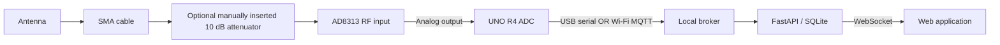

# Agentwin hardware integration

Hardware is not wired yet. Complete the local platform rehearsal first; this guide prepares the later wiring session. No physical measurement, module pinout, calibration, or wireless transport is certified by the software tests.

## First real test: external LED over USB

Start with only the UNO R4 WiFi, one ordinary LED, one **470 Ω** resistor, a breadboard, jumper wires, and the USB-C cable. Leave the AD8313 and all RF parts disconnected for this test.

The UNO R4 WiFi uses 5 V GPIO and Arduino documents an **8 mA maximum safe GPIO current**. A 470 Ω series resistor keeps a typical red LED near 6 mA: `(5 V - about 2 V) / 470 Ω`. LED forward voltage varies, so 470 Ω is the conservative default. Do not omit the resistor. See the official [UNO R4 WiFi datasheet](https://docs.arduino.cc/hardware/uno-r4-wifi) and [pinout](https://docs.arduino.cc/resources/pinouts/ABX00087-full-pinout.pdf).

Wire it with USB unplugged:

```text
UNO R4 D7 ── 470 Ω resistor ── LED long leg (anode)
LED short leg / flat side (cathode) ── UNO R4 GND
```

The resistor may be placed on either side of the LED as long as it remains in series. Check LED polarity before powering the board. This first test uses D7 because it is a plain digital GPIO and does not conflict with A0, USB serial, SPI, or the onboard D13 LED.

### Upload and run

1. Start Agentwin: `.\.venv\Scripts\python.exe -m uvicorn backend.main:app --host 127.0.0.1 --port 8000`.
2. In the web app, create an **LED or digital output** project. Set device identity to `uno-r4-01`, choose USB, enter the actual COM port, save, and note the generated project ID from the URL.
3. In Arduino IDE, install the **Arduino UNO R4 Boards** package and select **Arduino UNO R4 WiFi** plus the board's COM port.
4. Open `firmware/agentwin/agentwin.ino`. Keep `USE_WIFI_MQTT 0` and `LED_PIN 7`; replace `PROJECT_ID` with the generated project ID and keep `DEVICE_ID` equal to the identity saved in Agentwin.
5. Compile and upload. Close Serial Monitor afterward; only one program can own the serial port.
6. Start the local broker: `docker compose up -d broker`. If Docker is unavailable, start a native Mosquitto listener on `127.0.0.1:1883` using `broker/mosquitto.conf`.
7. Replace the placeholders and COM port below with the values saved in Agentwin, then start the gateway in another terminal:

   ```powershell
   .\.venv\Scripts\python.exe -m gateway.serial_gateway --port YOUR_COM_PORT --project YOUR_PROJECT_ID --device YOUR_DEVICE_ID
   ```

8. Press RESET on the UNO after the gateway opens. Agentwin accepts a new boot only when its first sample arrives within 30 seconds.
9. Open the created project's **Digital twin**. Confirm the source is **live**, the gateway becomes **online**, and the external LED reports **Off**.
10. Select **External LED**, then choose **Turn on**. The action first shows **requested**. It changes to **completed** only after the board reports `led_on: true` with the matching command ID. Repeat with **Turn off**.

If the button is disabled, verify that the selected session is live, Settings reports MQTT connected, and the USB gateway is online. If an action remains requested, check the gateway terminal, confirm Serial Monitor is closed, press RESET, and retry. A requested action is not proof that the LED changed.

## Two independent paths



The USB route includes the Python gateway before the broker. The attenuator can be bypassed in Project → Setup; enter the actual cable arrangement there. Inventory is not measured component health.

## Before wiring the RF hardware

Identify the exact AD8313 breakout vendor/model and obtain its schematic or module documentation. Confirm supply input, ground, analog output pin, output range, onboard regulation, and input protection. The chip's supply specification is **not** a verified breakout supply specification. Do not infer connector pinouts from the chip datasheet. No final pin-to-pin wiring is prescribed until that information is available.

The AD8313 is a logarithmic detector, not a spectrum analyzer. Analog Devices documents its 0.1–2.5 GHz operating range; a dual-band antenna does not establish 5 GHz detector coverage. See the [product documentation](https://www.analog.com/en/products/ad8313.html) and [Rev. F datasheet](https://www.analog.com/media/en/technical-documentation/data-sheets/AD8313.pdf).

The [UNO R4 WiFi](https://docs.arduino.cc/hardware/uno-r4-wifi/) has a configurable ADC. The sketch explicitly uses 12-bit resolution and `AR_DEFAULT`, with **nominal** 5.0 V in the calculation. Verify the actual reference voltage and output compatibility before connecting the module. Calculation: `counts × reference_voltage / 4095`. Counts and calculated voltage are preserved independently. The configuration is an assumption, not a calibration result. [Arduino ADC documentation](https://docs.arduino.cc/tutorials/uno-r4-wifi/adc-resolution/).

RF dBm is deliberately unavailable. A future calibration profile must record device/module identity, supply/reference, RF frequency, cable/attenuator setup, fitted conversion, measured valid voltage range, date and independent validation. Do not insert universal slope/intercept constants. A passive attenuator does not repair connectivity, and uncontrolled ambient readings need not change by exactly 10 dB.

## Firmware

Open `firmware/agentwin/agentwin.ino` in Arduino IDE with the **Arduino UNO R4 WiFi** board package. USB mode needs the core's Arduino/EEPROM support; Wi-Fi mode additionally needs ArduinoMqttClient. The repository does not contain a precompiled firmware binary: Arduino CLI was unavailable in the build environment.

1. Match `PROJECT_ID` and `DEVICE_ID` to the project's Setup tab.
2. Set `DETECTOR_PIN`, `ADC_BITS`, `ADC_REFERENCE_V`, and `SAMPLE_INTERVAL_MS` to the reviewed configuration. Update the backend ADC configuration if departing from the seeded 12-bit / 5 V defaults (no arbitrary ADC editor in this MVP).
3. Leave `USE_WIFI_MQTT=0` for USB. Serial output is newline-delimited JSON at **115200 baud**. Do not open Serial Monitor and the gateway simultaneously.
4. The EEPROM boot counter provides session identity and increments once per boot. EEPROM address 0–3 is reserved. Erasing/replacing the board's EEPROM requires a new live session/device registration. The 32-bit uptime wraps after approximately 49 days; reboot before that for the MVP.
5. USB mode reports Wi-Fi status/RSSI as null. Wi-Fi mode reads those values from the board interface; they are unrelated to detector voltage.

Optional compile once the toolchain is installed:

```powershell
arduino-cli core update-index
arduino-cli core install arduino:renesas_uno
arduino-cli lib install ArduinoMqttClient
arduino-cli compile --fqbn arduino:renesas_uno:unor4wifi firmware/agentwin
```

Record the installed core/library versions and compile output during that session. The sketch's reconnect attempts are spaced by five seconds; MQTT connection timeout is two seconds. WiFiS3 connection behavior remains subject to physical verification. Start the backend and gateway before resetting the board: a previously unseen boot must be observed within its first 30 seconds. This rejects arbitrary old first samples; it is not cryptographic clock synchronization.

## USB connection after wiring review

Start a local Mosquitto broker (Compose or native), then Agentwin. From the repository root:

```powershell
.\.venv\Scripts\python.exe -m gateway.serial_gateway --port COM3 --project smart-connectivity --device uno-r4-01
```

On Linux use `--port /dev/ttyACM0`; on macOS use the actual `/dev/cu.usbmodem...` path. Use `.venv/bin/python` outside Windows. Set OS serial access permissions as appropriate. Reset the board after the gateway opens, select **live** in the project, and confirm a new receipt timestamp, counts, and voltage.

The gateway validates schema and registered identity, bounds frames to 8 KiB, handles partial lines, retries serial access every three seconds, and publishes availability every three seconds. Broker outages drop samples rather than queueing stale telemetry. Gateway disconnected/unknown is separate from board Wi-Fi and missing telemetry. MQTT uses clean sessions, QoS 0 and non-retained telemetry. After a long gap, reboot a producer if its uptime has drifted from server receipt time beyond the freshness tolerance.

## Direct Wi-Fi on a private network

Do not expose the default anonymous broker configuration. Use `broker/private-network.conf.example` with generated password and ACL files (examples are supplied), and explicitly bind the broker host port to the laptop's private address. The web app/API stays on loopback. Limit firewall access to the private subnet/board. Do not open router forwarding.

Generate credentials with Mosquitto's `mosquitto_passwd` utility, e.g. `mosquitto_passwd -c passwords agentwin-backend`, then `mosquitto_passwd passwords uno-r4-01` (interactive passwords). Put both users into the ACL file; device access must be limited to its registered telemetry/status topics. Mount password/ACL files into `/mosquitto/config/` read-only and use the private-network configuration. Set the backend's `MQTT_USERNAME` / `MQTT_PASSWORD` to its own user, and gateway/device credentials separately if applicable. Keep all generated credential files outside version control.

Copy `secrets.example.h` to ignored `secrets.h`, fill in private network and broker settings, and set `USE_WIFI_MQTT=1`. Stop the USB gateway for that board. The sketch then publishes only through MQTT. Credentials on an unencrypted MQTT LAN are suitable only for an isolated trusted demonstration network; TLS and device provisioning are future work.

## Later physical acceptance

Verify supply/output compatibility; inspect wiring before power; then compare ADC voltage to a meter. Record raw values under stable conditions. Pause only this device's telemetry, observe stale data and the missing event, reconnect and confirm recovery. Manually change the configured measurement setup only when safe and record it in inventory. Do not disrupt a venue network. Neither a heartbeat loss nor an RF change establishes jamming or a specific root cause.
