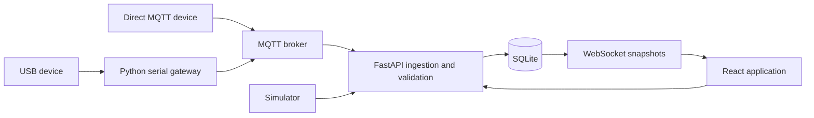

# Agentwin Platform Overview

## Purpose

Agentwin is a local-first platform for companies that operate multiple physical IoT systems. It gives each project an isolated operational workspace for live telemetry, device state, Digital Twin topology, events, verified controls, history, and a project-scoped assistant.

The platform separates four concerns:

1. **Platform project** — the saved Agentwin workspace, device registrations, telemetry schema, topology, events, actions, and sessions.
2. **Firmware project** — one independently buildable hardware implementation under `firmware/projects/`.
3. **Shared firmware libraries** — protocol and board support reused by firmware projects under `firmware/libraries/`.
4. **Device configuration** — project/device identity, pins, intervals, enabled components, and transport settings for one firmware build.

An Agentwin project may contain several devices. Identical hardware and behavior can reuse one firmware project with different configuration values. A separate firmware project is needed when board initialization, sensor drivers, calibration, actuator behavior, or safety rules differ.

## Vision

Agentwin should let an operator understand and control heterogeneous physical systems without creating a separate platform implementation for every board. Devices share a versioned telemetry and command contract, while hardware-specific firmware remains explicit, reviewable, and manually flashed.

The current MVP favors traceable evidence over automation. A command is not complete when the platform publishes it; it is complete only after the target device reports both the expected state and matching command ID. Missing telemetry means data is unavailable, not that Agentwin knows the physical cause.

## Core capabilities

- Create persistent projects without hardcoded project records.
- Register multiple USB or MQTT devices within a project.
- Validate project ID, device ID, field names, value types, boot sessions, sequence numbers, and message age.
- Store isolated live, simulated, and replay sessions.
- Render project topology and current component state in the Digital Twin.
- Detect missing telemetry and configured value conditions with evidence and recovery state.
- Execute declared actuator capabilities only in a live, ready device path.
- Verify actions from device telemetry using expected state plus command acknowledgement.
- Provide a project/session-scoped assistant that can inspect evidence but cannot autonomously operate hardware.

## Runtime architecture



All physical devices use the same topic pattern:

```text
agentwin/{project_id}/{device_id}/telemetry
agentwin/{project_id}/{device_id}/status
agentwin/{project_id}/{device_id}/command
```

## Firmware organization

```text
firmware/
├── libraries/
│   ├── AgentwinCore/       portable envelope, sessions, sequencing, validation, acknowledgement
│   ├── AgentwinArduino/    USB Serial and ArduinoMqttClient transports
│   ├── AgentwinUnoR4/      UNO R4 EEPROM boot identity and WiFiS3 networking
│   └── AgentwinAvr/        classic UNO EEPROM boot identity
└── projects/
    ├── arduino_uno_d13_led/    classic UNO, USB, built-in LED
    └── R4_jamming_detector/    UNO R4 WiFi, AD8313 input, supplied MLP
```

`AgentwinCore` must remain independent of GPIO, Wi-Fi, EEPROM, and specific sensors. Board dependencies belong in a board library. Project-specific hardware behavior belongs inside that firmware project's `src/` directory.

## Add a new project

### 1. Create the platform project

In Agentwin, select **Add project**, choose a starting template, enter each device identity and connector, and declare the required components and telemetry fields. After saving, read:

```text
GET /api/projects/{project_id}/devices/{device_id}/setup
```

Use the returned IDs, field keys, connector, topics, serial port, and baud rate as the firmware contract.

### 2. Decide whether firmware can be reused

- **Identical hardware and behavior:** reuse the existing firmware project and build it with another `project_config.h` containing the new project/device IDs and non-secret hardware settings. Keep Wi-Fi and MQTT credentials only in the ignored `secrets.h`.
- **Same board with different components:** copy the closest directory under `firmware/projects/`, replace its project-specific drivers and composition, and keep using the shared libraries.
- **Different board family:** create a new project directory and add a separately verified board-support library when needed. Keep ESP-specific networking, storage, and SDK includes outside `AgentwinCore`.

### 3. Create the isolated firmware directory

Each firmware project should contain:

```text
firmware/projects/my_device/
├── my_device.ino          thin composition and lifecycle
├── project_config.h       IDs, pins, fields, timing, enabled parts, transport; no secrets
├── secrets.example.h      credential names with placeholder values
├── sketch.yaml            board and external-library versions
├── README.md              wiring, compile, flash, and test procedure
└── src/                   only this project's sensor/actuator behavior
```

The directory and `.ino` filename must match for Arduino tooling.

### 4. Implement drivers and composition

A sensor implements `HardwareDriver::begin()` and `appendReadings()`. An actuator also implements `handlesCommand()` and `applyCommand()`, validates the command value type, performs the hardware change, and returns success. The shared core records a command acknowledgement only after a driver returns success.

The `.ino` file should only:

1. Include the selected shared libraries and local configuration/drivers.
2. Construct the transport and optional board network adapter.
3. Construct the project drivers and `AgentwinCore`.
4. Generate the board-specific boot ID in `setup()`.
5. Call the network adapter and core from `loop()`.

### 5. Compile

For the classic UNO reference project:

```powershell
arduino-cli compile `
  --fqbn arduino:avr:uno `
  --libraries firmware/libraries `
  firmware/projects/arduino_uno_d13_led
```

The project dependencies are:

| Dependency | Owner | Required for |
| --- | --- | --- |
| `AgentwinCore` | Repository shared library | Every Agentwin firmware project |
| `AgentwinArduino` | Repository shared library | Arduino USB/MQTT transports |
| `AgentwinUnoR4` | Repository board library | UNO R4 persistent boot ID and Wi-Fi |
| `AgentwinAvr` | Repository board library | Classic UNO persistent boot ID |
| ArduinoJson 7.2.1 | External Arduino library | Protocol serialization/parsing |
| ArduinoMqttClient 0.1.8 | External Arduino library | Direct MQTT builds only |
| WiFiS3 and EEPROM | UNO R4 board core | UNO R4 network/session support |
| Project drivers | Firmware project | Its physical sensors and actuators |

### 6. Flash and connect

For USB:

```powershell
arduino-cli upload `
  --port COM3 `
  --fqbn arduino:avr:uno `
  firmware/projects/arduino_uno_d13_led

.\.venv\Scripts\python.exe -m gateway.serial_gateway `
  --port COM3 --baud 115200 `
  --project YOUR_PROJECT_ID --device YOUR_DEVICE_ID
```

For direct MQTT, copy `secrets.example.h` to ignored `secrets.h`, select MQTT in `project_config.h`, configure a device-specific broker ACL, stop the USB gateway, compile, and upload.

### 7. Acceptance test

Automated compilation proves that the selected source builds for the configured board. Backend tests prove protocol and acknowledgement rules with software fixtures. A physical acceptance test must separately verify:

- Correct wiring and supply levels.
- Accepted live telemetry with an increasing sequence and a new boot ID after reset.
- Expected field names, types, units, and sampling rate.
- Actuator requests transition from `requested` to `completed` only after matching device telemetry.
- Disconnect, stale-data, reconnect, and recovery behavior.
- Physical output or an independent feedback sensor where physical proof matters.

## Configure the two-board concurrency test through the website

These are two separate platform projects and two separate firmware projects. Create both from **Overview → Add project** before editing their firmware IDs.

### Project 1: classic Arduino UNO built-in D13 LED over USB

1. **Name & template**
   - Project name: `Arduino UNO D13 LED`
   - Starting template: `LED output`
2. **Devices**
   - Device ID: `uno-d13-01`
   - Transport: `USB gateway`
   - Serial port: the classic UNO's Windows COM port, for example `COM4`
3. **Components**
   - Keep the generated LED component.
   - Label: `Built-in LED`
   - Type: `LED`
   - Device: `uno-d13-01`
   - Pin: `D13`
4. **Fields**
   - Component ID: `led`
   - JSON field: `led_on`
   - Type: `Boolean`
   - Unit: leave empty
5. **Timing**
   - Sample interval: `1` second
   - Freshness: `8` seconds
   - Retention: `30` days
6. Create the project and copy its generated project ID from the project URL or device setup response.
7. Put that ID in `firmware/projects/arduino_uno_d13_led/project_config.h`. Keep device ID `uno-d13-01`.
8. Compile and upload:

   ```powershell
   arduino-cli compile --fqbn arduino:avr:uno --libraries firmware/libraries firmware/projects/arduino_uno_d13_led
   arduino-cli upload --port COM4 --fqbn arduino:avr:uno firmware/projects/arduino_uno_d13_led
   ```

9. Close Serial Monitor and start its gateway:

   ```powershell
   .\.venv\Scripts\python.exe -m gateway.serial_gateway --port COM4 --baud 38400 --project YOUR_UNO_PROJECT_ID --device uno-d13-01
   ```

### Project 2: UNO R4 WiFi RF detector and MLP over MQTT

The UNO R4 WiFi exposes analog header pins A0-A5, so this project uses `A5`. `A10` is not an exposed UNO R4 WiFi header pin. The AD8313 is a logarithmic RF detector/controller over 0.1-2.5 GHz, not a spectrum analyzer. Do not treat its output or the supplied MLP classification as calibrated proof of jamming without validating the exact breakout, training data, ADC reference, RF setup, and model performance.

1. **Name & template**
   - Project name: `R4 RF Jamming Detector`
   - Starting template: `Connectivity / RF`
2. **Devices**
   - Device ID: `r4-rf-01`
   - Transport: `Wi-Fi MQTT`
3. **Components** — configure these five logical readings on the same device:

   | Label | Type | Device | Pin |
   | --- | --- | --- | --- |
   | RF detector voltage | Analog sensor | `r4-rf-01` | `A5` |
   | Rolling mean | Read only | `r4-rf-01` | `A5` |
   | Rolling standard deviation | Read only | `r4-rf-01` | `A5` |
   | Jamming probability | Read only | `r4-rf-01` | leave empty |
   | Model state | Read only | `r4-rf-01` | leave empty |

4. **Fields** — use these exact values because the backend rejects undeclared or mismatched fields:

   | Component ID | JSON field | Type | Unit | Precision |
   | --- | --- | --- | --- | ---: |
   | `rf-detector` | `rf_detector_v` | Number | `V` | 3 |
   | `rf-mean` | `rf_mean_v` | Number | `V` | 3 |
   | `rf-std` | `rf_std_v` | Number | `V` | 3 |
   | `jamming-probability` | `jamming_probability_percent` | Number | `%` | 1 |
   | `jamming-state` | `jamming_state` | Text | leave empty | 0 |

5. **Timing**
   - Sample interval: `1` second
   - Freshness: `5` seconds
   - Retention: `30` days
6. Create the project and copy its generated project ID into `firmware/projects/R4_jamming_detector/project_config.h`. Keep device ID `r4-rf-01`.
7. Copy `secrets.example.h` to ignored `secrets.h` in the same directory. Enter the private Wi-Fi SSID/password, the laptop's LAN IP as `MQTT_HOST` rather than `127.0.0.1`, and the device's MQTT credentials.
8. Compile and upload:

   ```powershell
   arduino-cli compile --fqbn arduino:renesas_uno:unor4wifi --libraries firmware/libraries firmware/projects/R4_jamming_detector
   arduino-cli upload --port COM3 --fqbn arduino:renesas_uno:unor4wifi firmware/projects/R4_jamming_detector
   ```

9. Do not run a USB gateway for `r4-rf-01`. Its firmware publishes directly through Wi-Fi MQTT.

### RF connection boundary

The intended signal path is:

```text
Bingfu antenna → SMA coax → optional 10 dB attenuator → AD8313 RF input
AD8313 DC output → UNO R4 A5
AD8313 ground → UNO R4 ground
```

Confirm the exact module vendor schematic and labels before connecting power. The AD8313 IC supports a 2.7-5.5 V supply, but a breakout board can add regulators, dividers, different labels, or other circuitry. Verify the breakout supply pin, ground, output range, and polarity with its documentation and a meter. The 10 dB attenuator changes RF input level; it does not protect an incorrectly wired DC output.

### Concurrent-operation evidence

1. Start the broker and Agentwin backend.
2. Start only the classic UNO's USB gateway. The R4 connects directly to the broker.
3. Confirm both project workspaces show fresh, increasing live telemetry.
4. Navigate repeatedly between Overview, both project pages, Digital Twin, and Live readings. Ingestion should continue because it runs in the backend rather than the active browser page.
5. Unplug the classic UNO. Its project should become stale and open a missing-telemetry event after eight seconds; the R4 project should remain fresh.
6. Reconnect the classic UNO and confirm a new AVR boot ID and recovery.
7. Disconnect R4 Wi-Fi or power. Its project should become stale after five seconds while the classic UNO remains fresh and its D13 control still completes through matching acknowledgement.
8. Record both project IDs, device IDs, boot IDs, receipt timestamps, the disconnect/recovery events, and one completed D13 on/off pair.

## Current constraints

- Firmware configuration and flashing are manual.
- No firmware generation, OTA, remote pin configuration, or credential provisioning.
- The MVP is a single local operator application without production tenant authentication.
- MQTT over an unencrypted private demonstration network is supported; production TLS and device identity are future work.
- The classic UNO D13 and R4 RF firmware projects compile. They still need physical acceptance with their website-generated project IDs. UNO R4 direct Wi-Fi/MQTT still needs physical network and ACL acceptance.
- ESP support is not claimed until an ESP board adapter and at least one ESP firmware project compile and pass a physical test.
- The D7 state confirms the value written by firmware; it does not independently prove emitted light.

## Suggested improvements

1. Add a checked-in project template directory with placeholder configuration and a minimal sensor driver.
2. Add CI that compiles every directory under `firmware/projects/` with its pinned board profile and local libraries.
3. Add host-side tests for malformed commands and driver rejection through a small fake transport/driver harness.
4. Move transport selection from preprocessor flags to per-project build profiles when the supported board matrix grows.
5. Add version compatibility metadata between firmware projects and telemetry schema versions.
6. Add TLS, per-device credentials, certificate rotation, and broker ACL verification before remote deployment.
7. Add calibration records and unit conversions per physical sensor rather than embedding unverified constants in shared code.
8. Add an ESP-specific library and example only after selecting the exact ESP target and networking stack.
